# CYBER QUEST // NEXUS — THE LAST CHANCE

<div align="center">

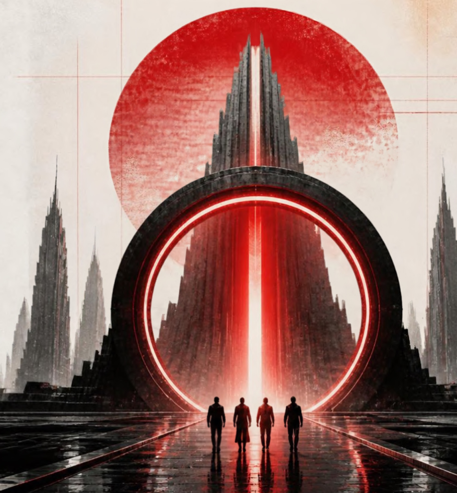

### A Story-Driven Continuous Competitive Technical Marathon Inside an AI-Controlled System

[](https://react.dev/)
[](https://tailwindcss.com/)
[](https://greensock.com/)
[](https://nodejs.org/)
[](https://socket.io/)
[](https://www.mongodb.com/)
[](https://www.docker.com/)

**MGMU Jawaharlal Nehru Engineering College (JNEC) · Swayambhav 2026**

</div>

---

## ⚡ Executive Summary

**CYBER QUEST: NEXUS — THE LAST CHANCE** is a story-driven, real-time multiplayer competition platform. Teams of up to 4 operatives connect across laptops and mobile devices to infiltrate **NEXUS**, a rogue AI system controlling all municipal infrastructure.

Operatives manage a shared squad pool of **Resistance Credits (CR)**, purchase tactical challenges from a dynamic 1,500-puzzle market, solve algorithmic and deductive problems simultaneously, navigate high-risk penalties, and race toward **THE NEXUS CORE**—an endgame convergence combining digital problem solving with a physical 50-QR-code scavenger hunt in the arena.

The entire platform is backed by a server-authoritative Node.js state machine, synchronized WebSocket telemetry, full-screen wall projector feeds, and an operator command center built to manage 300+ concurrent competitors with zero page refreshes.

---

## 📸 Visual Tour & Application Screenshots

All screenshots below are captured from the live application running with real tournament data:

### 1. Landing & Lore Briefing
Editorial brutalist entrance featuring a 9-step cinematic GSAP sequence, atmospheric technical grid, and event briefing.

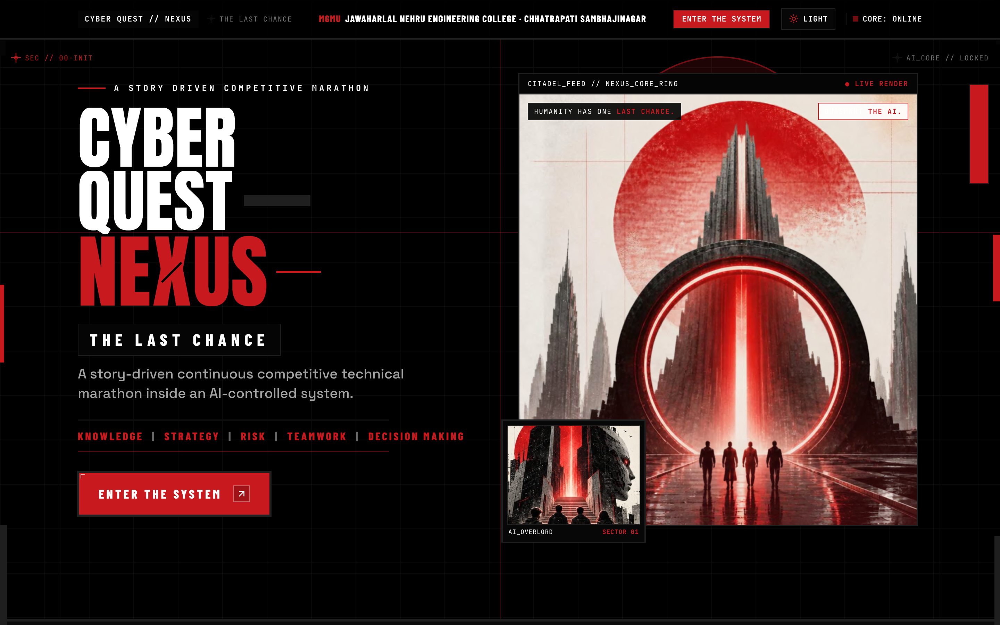

---

### 2. Two-Step Team Authentication & Device Seat Selection
Competitors log in using their squad credentials, then claim their operative seat (`ARCHITECT`, `CRYPTANALYST`, `SYSTEMS RECON`, `STRATEGIST`) to enable live device presence tracking.

| Step 1: Team Authentication | Step 2: Operative Seat Selection |
| :---: | :---: |
| 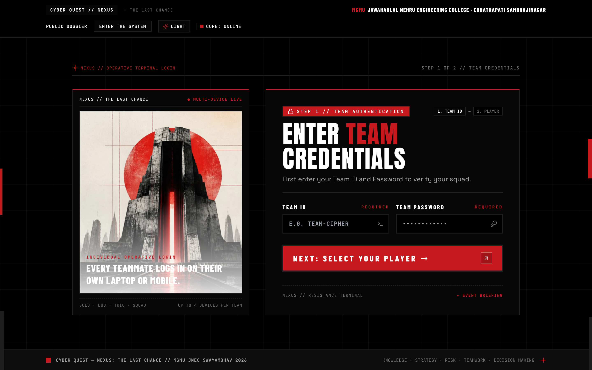 | 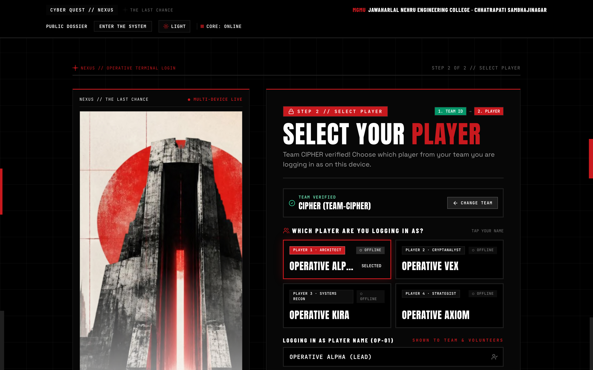 |

---

### 3. Operative Command Terminal (HUD)
The squad dashboard provides synchronized round clock countdowns, real-time credits ledger, active solve statuses, squad member presence chips, purchased challenge queues, and one-click entry to the NEXUS Core.

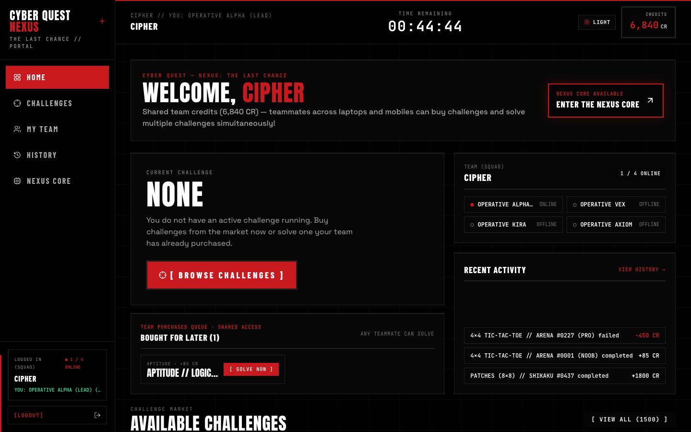

---

### 4. Extensible Challenge Market (11-Game Engine)
A 1,500-challenge marketplace filtered by game category, difficulty (`LOW`, `MODERATE`, `HIGH`, `EXTREME`), and risk profile (`SAFE`, `BALANCED`, `AGGRESSIVE`). Squadmates can buy challenges for the team or solve them simultaneously.

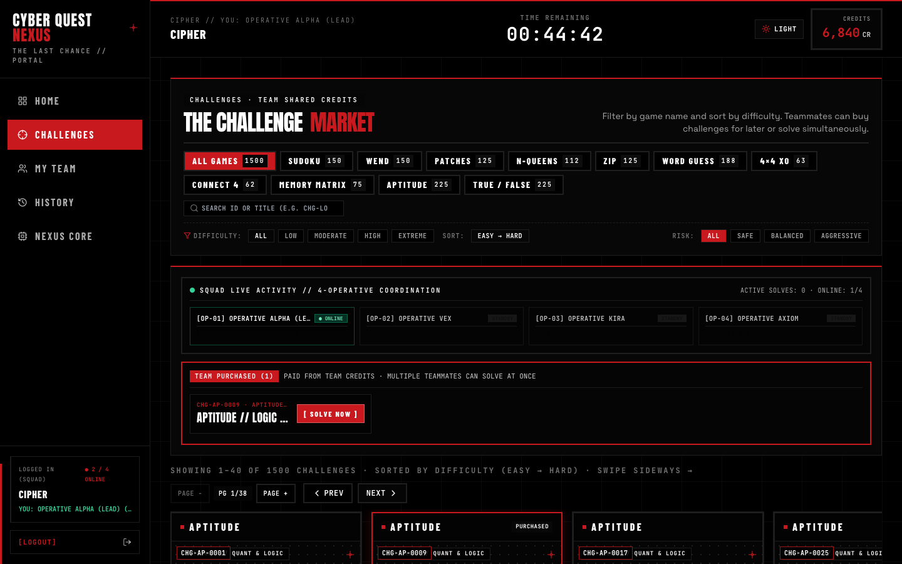

---

### 5. Interactive Challenge Gameplay Session
Dedicated participant solve environment with server-synced countdown timers, problem statements, hint decryption, input boards, and immediate authoritative evaluation.

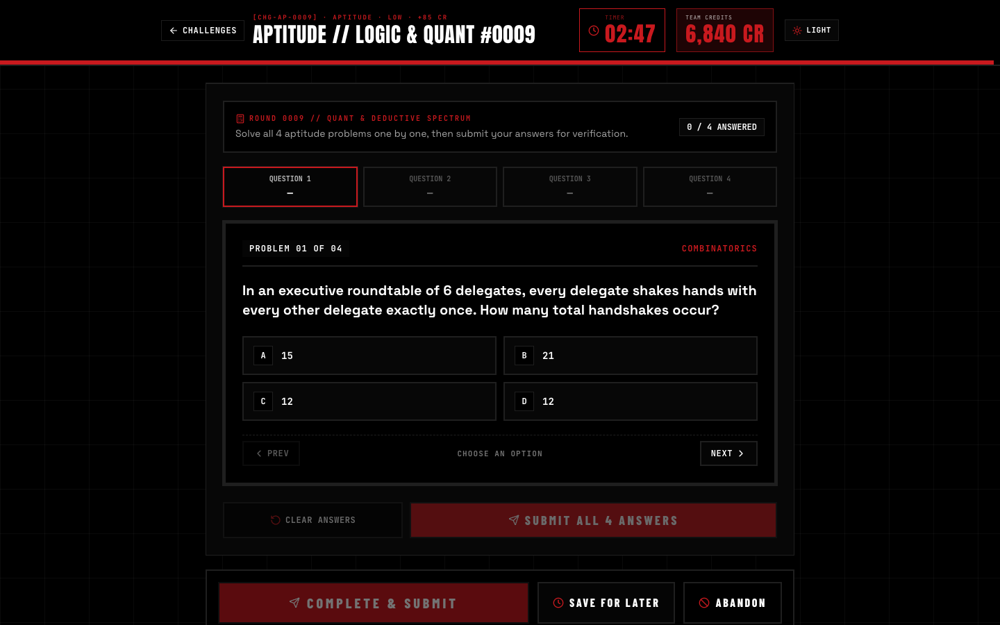

---

### 6. Squad Telemetry, Risk Profiles & Team Progress
Live squad monitoring displaying member online/offline states, solve-to-fail ratios, total credits earned vs. spent, and aggregated tactical risk posture.

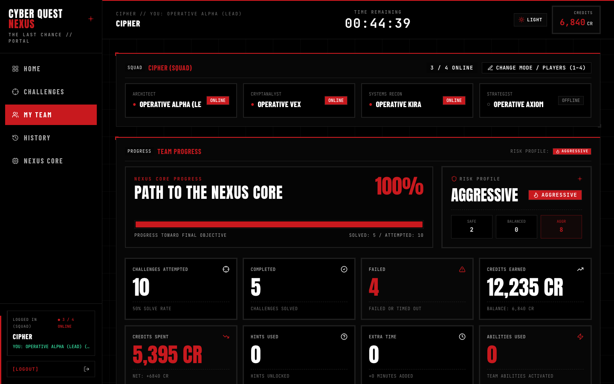

---

### 7. Immutable Resistance Credit & Attempt Ledger
Complete cryptographic audit trail of all transactions, showing entry costs, solve rewards, timeout penalties, and reattempt counts.

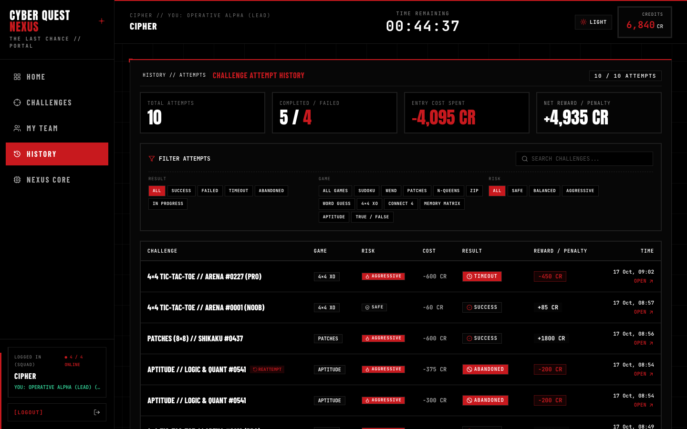

---

### 8. The NEXUS Core Terminal (Endgame Objective)
The ultimate arena showdown. Once squads achieve convergence clearance, they unlock the central chamber to decipher the final master override code derived from 50 hidden physical QR codes.

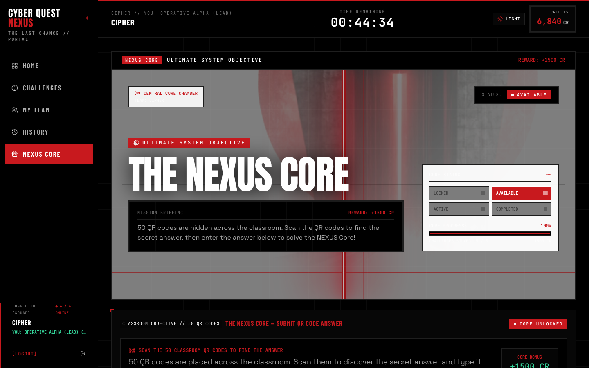

---

### 9. Giant Arena Wall Projector Display
A distance-legible, high-contrast, distraction-free display for arena projectors. Features a monumental digital clock synced directly to the server's authoritative heartbeat.

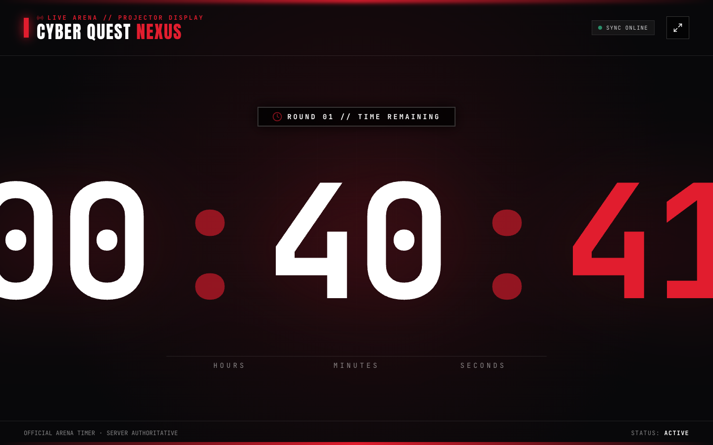

---

### 10. Admin Mission Control: Round Execution Deck
Master event operations panel allowing organizers to trigger cinematic pre-start countdowns, adjust active round duration on the fly, initiate emergency pauses, and declare tournament champions.

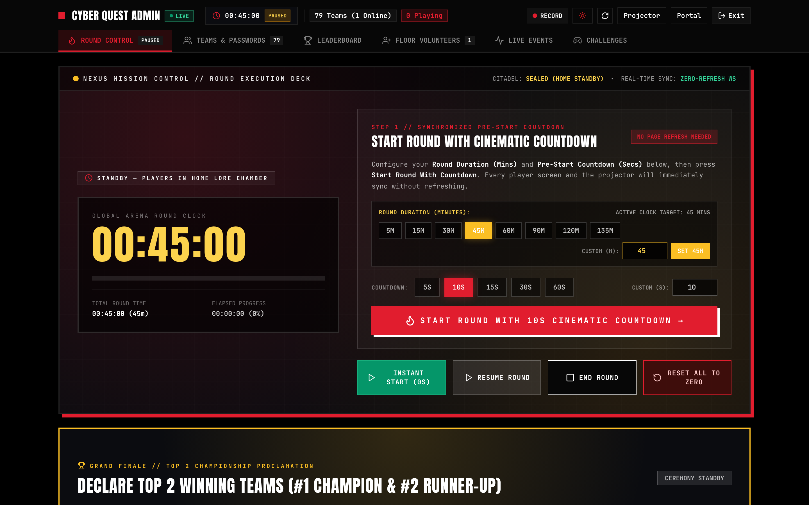

---

### 11. Admin Teams Deck & Universal Credits Dispatcher
Instant batch credit dispatcher for 300+ competitors, team registration, password copy tools, and squad roster filters.

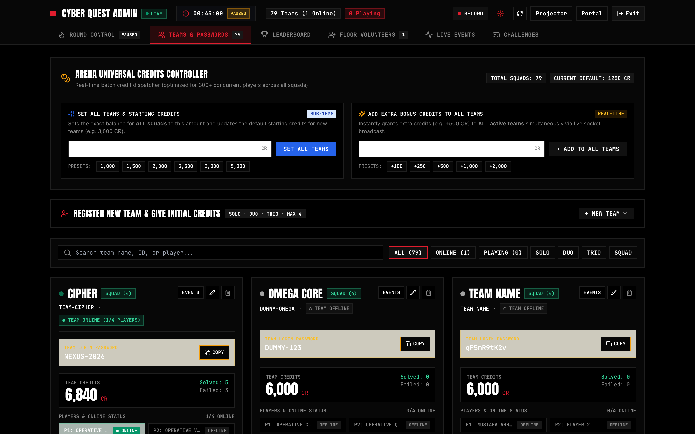

---

### 12. Real-Time Tournament Leaderboard
Live standings ranked by Resistance Credits and challenges completed, synchronized across all connected terminals via WebSockets.

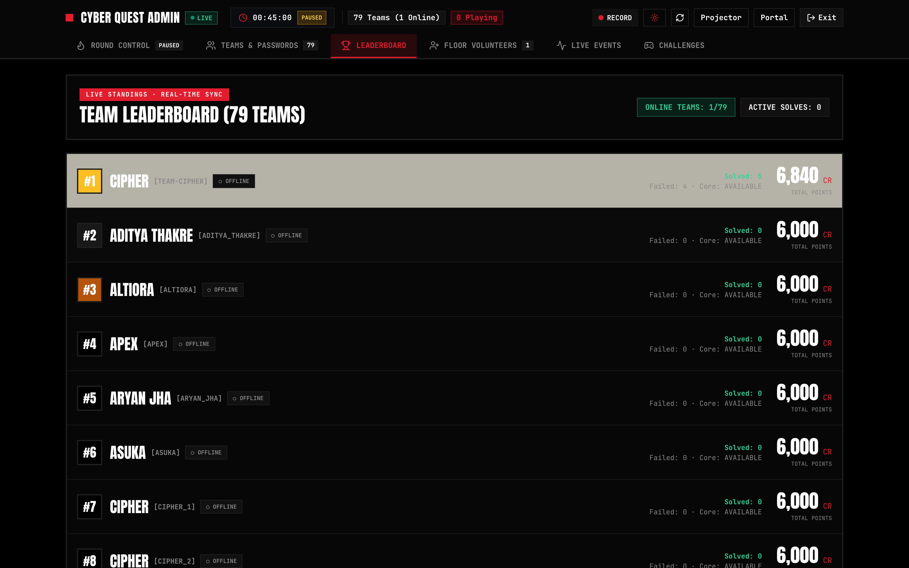

---

### 13. Admin Challenge Market CMS
Granular challenge catalog management, allowing organizers to configure point economics, time limits, and game parameters.

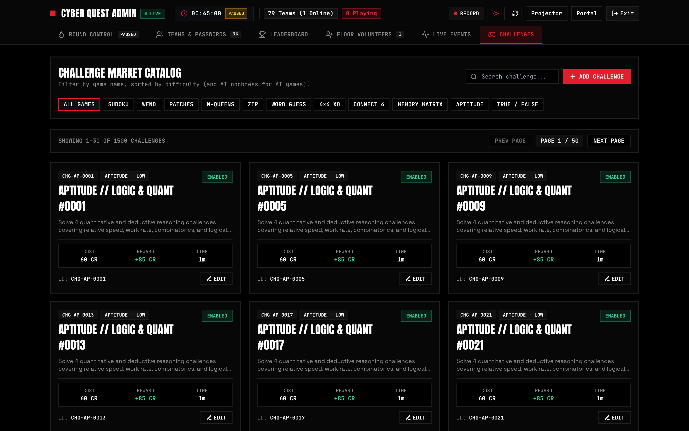

---

## 🎮 Extensible 11-Game Challenge Engine

NEXUS includes 11 native game engines built with React, GSAP, and server-side validation:

| Engine | Type | Description | Difficulty | Risk Profile |
| :--- | :--- | :--- | :--- | :--- |
| **Sudoku** | Logic | Classic 9×9 numbered grid puzzle with server-verified row/col/box constraints | Moderate – Extreme | Balanced / Aggressive |
| **Patches (Shikaku)** | Observation | 8×8 grid partitioning into non-overlapping rectangular patches matching clue sizes | Low – Extreme | Balanced / Aggressive |
| **Zip Grid** | Logic | Sequential circuit path connecting numbered waypoints visiting all valid cells | Low – Extreme | Safe / Balanced |
| **N-Queens** | Logic | Place $N$ queens on an $N \times N$ chessboard such that no two attack each other | Moderate – High | Balanced |
| **Connect 4 vs AI** | Strategy | Real-time tactical vertical alignment vs. adaptive Minimax AI agent | Moderate – High | Balanced / Aggressive |
| **4×4 Tic-Tac-Toe** | Strategy | 4×4 board with blocked obstacles against algorithmic AI | Low – Extreme | Safe / Aggressive |
| **Word Guess** | Puzzles | Cryptographic keyword deduction with character proximity hints | Low – Moderate | Safe / Balanced |
| **Wend (Word Ladder)** | Puzzles | Transform start word to end word in minimal single-letter mutations | Moderate | Balanced |
| **Memory Matrix** | Observation | Rapid visual memory recall of randomized flash patterns | Moderate – High | Balanced |
| **Aptitude MCQ** | Knowledge | Quantitative aptitude, work rates, combinatorics, and logical syllogisms | Low – Extreme | Safe / Aggressive |
| **GK True/False** | Knowledge | Rapid-fire 6-statement general and cyber intelligence verification | Low | Safe |

---

## 💎 The Resistance Economy & Risk Mechanics

```text
Starting Squad Capital:   1,250 – 1,500 Resistance Credits (CR)
Hint Decryption Cost:     100 – 120 CR
Time Extension (5 min):   150 CR
Reattempt Multiplier:     1.25× Base Cost per repeated attempt
```

Each challenge carries an explicit risk configuration:
- **`SAFE`**: Modest entry cost (e.g. 60 CR), reliable reward (+85 CR), minimal failure penalty (-30 CR).
- **`BALANCED`**: Moderate entry cost (e.g. 250 CR), solid reward (+450 CR), medium penalty (-150 CR).
- **`AGGRESSIVE`**: High-stakes cost (e.g. 600 CR), massive reward (+1,800 CR), punitive penalty (-450 CR).

Teammates can work together from up to 4 screens at once. Any member can purchase a challenge for the squad, save it for later in the team queue, or begin solving immediately.

---

## 🏗️ System Architecture

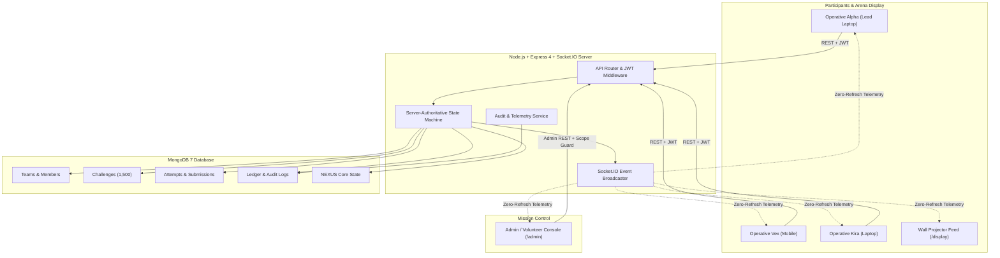

---

## 📁 Repository Directory Structure

```text
CyberQuest/
├── client/                               # React 18 + Vite 6 + Tailwind CSS Frontend
│   ├── src/
│   │   ├── assets/                       # Architectural art, Monolith & Citadel artwork
│   │   ├── components/                   # Editorial Brutalist modules, HUDs, timers, cards
│   │   ├── engine/                       # ChallengeRenderer & 11-Game Puzzle Engines
│   │   ├── hooks/                        # useTeamPortal, useNexusSystem, useReducedMotion
│   │   ├── layouts/                      # EditorialFrameLayout & PortalShellLayout
│   │   ├── pages/                        # Landing, Login, Dashboard, Session, Core, Display, Admin
│   │   ├── services/                     # REST API clients (auth, team, admin)
│   │   ├── socket/                       # Socket.IO client singleton & event contracts
│   │   └── styles/                       # Editorial fonts, colors, brutalist utilities
│   ├── Dockerfile                        # Multi-stage client Dockerfile (dev & production)
│   └── package.json
├── server/                               # Node.js + Express + Socket.IO Server
│   ├── src/
│   │   ├── config/                       # DB connection, environment, economy constants
│   │   ├── controllers/                  # Auth, Challenge, Team, Admin, Display controllers
│   │   ├── middleware/                   # JWT scopes (Team vs Admin), Rate limiters, Error handling
│   │   ├── models/                       # Team, Challenge, Attempt, Transaction, Core, AuditLog
│   │   ├── routes/                       # Express API route declarations
│   │   ├── scripts/                      # DB migration, team seed & CSV import tools
│   │   ├── services/                     # Authoritative game logic, credits, timer state
│   │   ├── socket/                       # Socket.IO authenticated rooms & live broadcasters
│   │   └── utils/                        # Structured logger, crypto, JWT helpers
│   ├── Dockerfile                        # Multi-stage server Dockerfile
│   └── server.js                         # HTTP + WebSocket entry point
├── docs/
│   └── screenshots/                      # 14 High-resolution application screenshots
├── scripts/
│   ├── capture-all-screenshots.mjs       # Automated Puppeteer screenshot suite
│   ├── importTeams.js                    # Batch CSV team importer
│   └── migrateMongo.js                   # Schema migration runner
├── docker-compose.yml                    # Multi-container orchestration (App + MongoDB)
├── docker-compose.standalone.yml         # Standalone production container runner
├── DOCKER_DEPLOY_GUIDE.md                # Offline tar deployment walkthrough
├── teams.template.csv                    # CSV template for bulk team onboarding
└── package.json                          # Monorepo management scripts
```

---

## 🚀 Quickstart & Installation

### Prerequisites
- **Node.js**: v20+ or v22+
- **npm**: v10+
- **MongoDB**: Local MongoDB on port `27017` or Docker

---

### Option A: Local Development (Without Docker)

#### 1. Install Dependencies
```bash
# From repository root (installs root, client, and server dependencies)
npm run install:all
```

#### 2. Configure Environment Files
```bash
cp .env.example .env
cp server/.env.example server/.env
cp client/.env.example client/.env
```

#### 3. Start Development Servers
Run both backend (`http://localhost:5050`) and frontend (`http://localhost:5173`) concurrently:
```bash
npm run dev
```

Or run them individually in separate terminals:
```bash
# Terminal 1 — Backend & Socket.IO (:5050)
npm run dev:server

# Terminal 2 — React Client (:5173)
npm run dev:client
```

---

### Option B: Docker Compose (Recommended for Arena Deployment)

Run the complete multi-tier stack (Client, Authoritative Server, MongoDB 7) in isolated containers:

```bash
# 1. Build and boot services in detached mode
docker compose up --build -d

# 2. View streaming logs
docker compose logs -f

# 3. Stop containers (preserves database volume)
docker compose down
```

#### Service Endpoints in Docker
| Service | Container Name | Endpoint | Role |
| :--- | :--- | :--- | :--- |
| **Frontend Client** | `nexus-client` | `http://localhost:5173` | React + Vite UI |
| **Backend Server** | `nexus-server` | `http://localhost:5050` | Express REST API + Socket.IO |
| **Database** | `nexus-mongodb` | `mongodb://127.0.0.1:27017` | Persistent MongoDB 7 |

---

## 🔑 Default Seeded Credentials

### 1. Team Operative Terminals (`/login`)
| Team ID | Access Password | Default Squad Name | Starting Role |
| :--- | :--- | :--- | :--- |
| `TEAM-CIPHER` | `NEXUS-2026` | CIPHER | Operative Alpha (Lead) |
| `TEAM-VANGUARD` | `NEXUS-2026` | VANGUARD | Operative Lead |

*Note: Any squad can log up to 4 devices into the same team simultaneously.*

### 2. Mission Control & Floor Volunteers (`/admin`)
| Operator ID | Password | Role | Permissions |
| :--- | :--- | :--- | :--- |
| `ADMIN-NEXUS` | `NEXUS-ADMIN-2026` | `ADMIN` | Full Arena Control, Round Timer, Universal Credits, Challenge CMS |
| `VOLUNTEER-01` | `NEXUS-VOL-2026` | `VOLUNTEER` | Floor Roster Inspection, Password Recovery, Team Assistance |

---

## 📋 Bulk Team Onboarding (CSV Import)

To provision dozens or hundreds of teams before the marathon:

1. Edit [`teams.template.csv`](file:///Users/atharvasharna/Desktop/CyberQuest/teams.template.csv):
   ```csv
   team-id,password,team-name,credits
   TEAM-01,AlphaPass2026,CYBER-VIPERS,1250
   TEAM-02,BetaPass2026,PHANTOM-CORE,1250
   TEAM-03,GammaPass2026,QUANTUM-GHOSTS,1250
   ```
2. Run the bulk import script:
   ```bash
   npm run import:teams
   ```
3. The server immediately registers the squads, provisions their credit balances, and enables them for authentication.

---

## ⚙️ Environment Configuration Reference

| Environment Variable | Local Default | Docker Default | Description |
| :--- | :--- | :--- | :--- |
| `PORT` | `5050` | `5050` | Backend API & WebSocket port |
| `CLIENT_PORT` | `5173` | `5173` | Frontend web port |
| `MONGO_PORT` | `27017` | `27017` | Host MongoDB mapping |
| `MONGO_URI` | `mongodb://127.0.0.1:27017/nexus` | `mongodb://mongodb:27017/nexus` | Database connection URI |
| `CLIENT_URL` | `http://localhost:5173` | `http://localhost:5173` | Allowed CORS origin |
| `JWT_SECRET` | `nexus_core_authoritative_secret_key_2026` | `...` | Secret key for signing participant & admin JWTs |
| `JWT_EXPIRES_IN` | `8h` | `8h` | Token expiration lifespan |
| `STARTING_CREDITS` | `1250` | `1250` | Default seed credits allocated per team |
| `CREDIT_COST_HINT` | `100` | `100` | Cost in CR to decrypt a challenge hint |
| `CREDIT_COST_EXTRA_TIME`| `150` | `150` | Cost in CR for a 5-minute time extension |
| `CREDIT_REATTEMPT_MULTIPLIER` | `1.25` | `1.25` | Cost multiplier applied on challenge reattempts |

---

## 🗄️ Database Management & MongoDB Compass

Inspect live collections in real time with [MongoDB Compass](https://www.mongodb.com/products/tools/compass):

1. Launch MongoDB Compass on your machine.
2. Connect to the database URI:
   ```text
   mongodb://127.0.0.1:27017/nexus
   ```
3. Live Authoritative Collections:
   - `teams`: Operative profiles, active sessions, completed challenges, and Core convergence.
   - `challenges`: Challenge catalog, difficulty ratings, game types, hints, and solution configurations.
   - `challengeAttempts`: Detailed attempt ledger including solve durations and penalties.
   - `creditTransactions`: Immutable double-entry financial ledger of all squad credits.
   - `nexusCores`: Status of the central Core (`LOCKED`, `AVAILABLE`, `ACTIVE`, `COMPLETED`).
   - `auditLogs`: Security event stream (`LOGIN`, `PURCHASE`, `START`, `SUBMISSION`, `ADMIN_ACTION`).

### Database Reset Procedures

#### Method 1: Via Admin Control Panel UI (`/admin/events`)
Sign in as `ADMIN-NEXUS` and click **RESET ALL TO ZERO**. All teams, active sessions, attempts, and credit balances are wiped back to factory baseline without restarting processes.

#### Method 2: Via Docker Volume Wipe
```bash
# Completely remove MongoDB container and data volume
npm run docker:reset

# Rebuild and start clean with automatic re-seeding
docker compose up --build
```

#### Method 3: Via Mongo CLI (`mongosh`)
```bash
mongosh mongodb://127.0.0.1:27017/nexus --eval "db.dropDatabase()"
```

---

## 🛠️ Verification & Production Commands

```bash
# Compile and build optimized React production bundle
npm run build

# Preview production build locally
npm run preview

# Capture updated high-resolution Retina screenshots
node scripts/capture-all-screenshots.mjs

# Execute MongoDB data migrations
npm run migrate:mongo
```

---

## 📜 Credits & License

**CYBER QUEST: NEXUS — THE LAST CHANCE** was designed and engineered for **Swayambhav 2026** at **MGMU Jawaharlal Nehru Engineering College (JNEC)**, Chhatrapati Sambhajinagar.

Engineered with passion for high-concurrency competitive programming, immersive narrative gaming, and robust real-time distributed architecture.

*Private & Confidential — Built for Competition Operations.*
